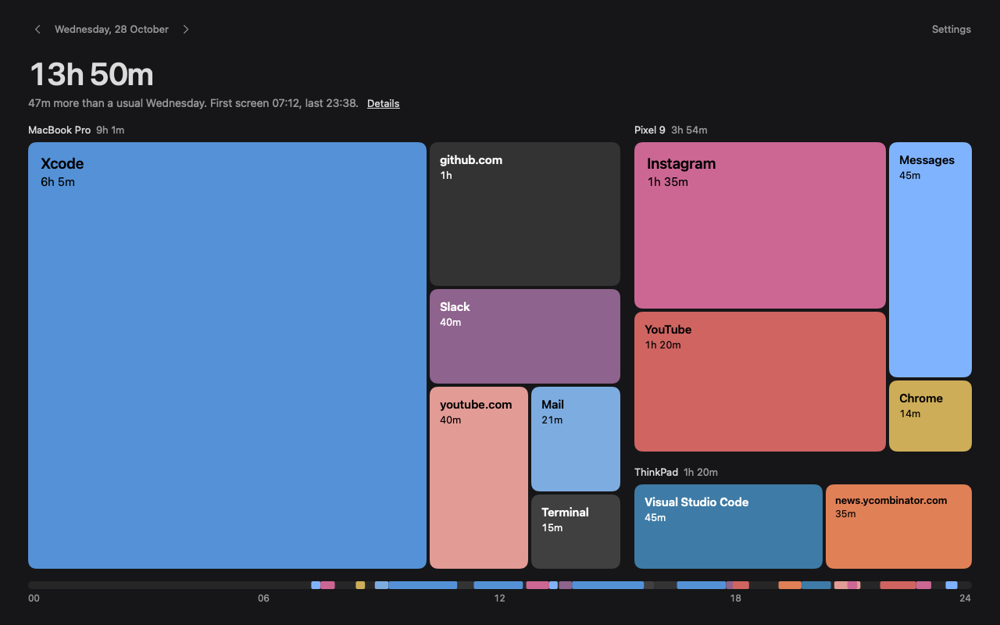
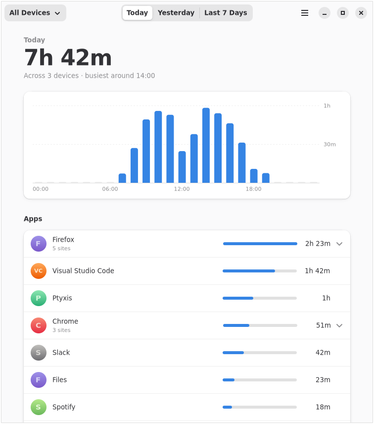

<p align="center">
  
</p>

<h1 align="center">Spent Day</h1>

<p align="center">
  Screen time for all your devices, in one dashboard.<br>
  Open source, with end-to-end encrypted sync to a server you run.
</p>

<p align="center">
  
  
  
</p>

<p align="center">
  
  
  
</p>

Spent Day records which app, and which website, is in front of you on your Mac, your Linux machine and your Android phone. Sync puts them all on one dashboard. If your browser had 2 hours today, Spent Day shows how much of that went to YouTube, GitHub or the news.

- **All your devices.** Every device shows one dashboard with the time from all of them.
- **Sites, not just apps.** Browser time is split by domain. Private and incognito windows aren't recorded.
- **Nothing you didn't ask for.** It keeps app names, domains, times and device names. Never a full web address, a page title or a window title.
- **Your server, your key.** Sync encrypts everything with a code only your devices have. The server can't read it.
- **Native apps.** SwiftUI on macOS, GTK 4 and libadwaita on Linux, Jetpack Compose on Android, all on one Rust core.

## Get started

There are no releases yet, so you build from source. Every app needs [Rust](https://rustup.rs) stable. There's no iOS app, because Apple doesn't let apps export Screen Time data, and no Windows app yet.

| Platform | You need | Guide |
|---|---|---|
| macOS 14 or later | Apple Silicon, Xcode 16 or its Command Line Tools | [apps/macos](apps/macos/README.md) |
| Linux | GTK 4.18 and libadwaita 1.7. Works on GNOME, KDE, Sway, Hyprland and X11 | [apps/linux](apps/linux/README.md) |
| Android 8 or later | JDK 21, the Android SDK and NDK | [apps/android](apps/android/README.md) |
| Browser extension | Firefox on macOS, and every browser on Linux | [extension](extension/README.md) |

On a Mac:

```sh
git clone https://github.com/cravenceiling/spent-day && cd spent-day
apps/macos/make-dev-cert.sh   # once, so permissions survive rebuilds
apps/macos/build.sh && apps/macos/install.sh
```

On Linux, after installing the GTK and libadwaita development files:

```sh
apps/linux/install.sh
```

To sync, run [`spentday-server`](server/README.md) behind HTTPS, create a sync code on one device, and join with it on the others.

## Docs

- [Privacy](docs/PRIVACY.md): what is stored, what sync sends, and which private windows are skipped.
- [Design](docs/DESIGN.md): the data model, the sync protocol, and how each platform collects.
- [Testing](docs/TESTING.md): what has been tested on real builds, and how to run the checks.

## Repository

| Path | What it is |
|---|---|
| [`core/`](core/README.md) | Rust core for storage, summaries, website attribution and sync. Swift and Kotlin call it through UniFFI. |
| [`apps/`](apps) | The macOS, Linux and Android apps. |
| [`extension/`](extension/README.md) | WebExtension for Chrome and Firefox. |
| [`server/`](server/README.md) | Self-hosted sync server that stores encrypted batches only. |
| [`cli/`](cli/README.md) | `spentday-cli`, to inspect a database, simulate a device, or sync from a terminal. |

## License

[MIT](LICENSE)
