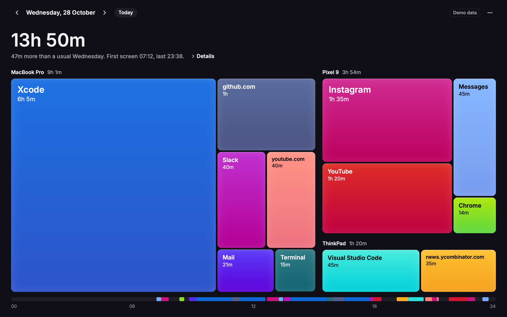
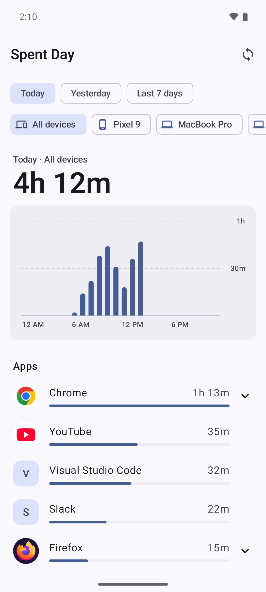

<p align="center">
  
</p>

<h1 align="center">Spent Day</h1>

<p align="center">
  Screen time for all your devices, in one dashboard.<br>
  Open source, with end-to-end encrypted sync to a server you run.
</p>

<p align="center">
  
  
  
</p>

<p align="center">
  
  
  
</p>

Spent Day records which app, and which website, is in front of you on your Mac, your Linux machine and your Android phone. Sync puts them all on one dashboard. If your browser had 2 hours today, Spent Day shows how much of that went to YouTube, GitHub or the news.

- **All your devices.** Every device shows one dashboard with the time from all of them.
- **Sites, not just apps.** Browser time is split by domain. Private windows report no site. Safari sites stay off unless enabled, because Safari cannot identify private windows.
- **Nothing you didn't ask for.** It keeps app names, domains, times and device names. Never a full web address, a page title or a window title.
- **Your server, your key.** Sync encrypts everything with a code only your devices have. The server can't read it.
- **Desktop and Android.** One Rust desktop app on Rune for macOS and Linux, and Jetpack Compose on Android, share the Rust core.

## Desktop app

The [desktop guide](apps/desktop/README.md) covers macOS 14 or later on Apple Silicon and Linux on GNOME, KDE, Sway, Hyprland and X11. Building needs [Rust](https://rustup.rs) stable and a C compiler. macOS also needs Apple's Command Line Tools. Linux needs pkg-config, libxkbcommon and Wayland development files, plus a Vulkan driver to render.

On macOS, from the repository root:

```sh
apps/desktop/macos/make-dev-cert.sh   # optional stable local signing identity
apps/desktop/macos/bundle.sh
apps/desktop/macos/install.sh
```

On Debian 13 or Ubuntu with recent Mesa:

```sh
sudo apt install build-essential pkg-config libxkbcommon-dev libwayland-dev libxkbcommon-x11-0 libx11-6 libx11-xcb1 libxcursor1 libxi6 mesa-vulkan-drivers libvulkan1
apps/desktop/linux/install.sh
```

macOS starts in the menu bar, with onboarding on the first launch. Linux opens the dashboard. Closing the dashboard keeps tracking. `--background` or `-b` starts without a window; `--dashboard` opens it; `--settings` opens its Settings overlay; `--day YYYY-MM-DD` selects a date, with invalid dates falling back to today. `--demo` uses sample data without opening the database or starting tracking, the extension listener or automatic sync. The last launch flag wins. Use Quit Spent Day or Cmd/Ctrl+Q to stop and flush tracking.

To sync, run [`spentday-server`](server/README.md) behind HTTPS, create a sync code on one device, and join with it on the others.

## Android and browser extension

[Android 8 or later](apps/android/README.md) needs JDK 21, the Android SDK and NDK. The [browser extension](extension/README.md) reports sites for Firefox on macOS and browsers on Linux. There's no Windows app yet. Apple does not let iOS apps export Screen Time data.

## Releases

Download from [Releases](https://github.com/cravenceiling/spent-day/releases):

| Platform | Download | Get started |
|---|---|---|
| macOS 14+, Apple Silicon | `SpentDay-<version>-arm64.dmg` | Open it and drag Spent Day to Applications. |
| Debian 13 / Ubuntu 24.04+, x86_64 | `spentday_<version>-1_amd64.deb` | `sudo apt install ./spentday_<version>-1_amd64.deb` |
| Linux, x86_64, glibc 2.35+ | `SpentDay-<version>-x86_64.AppImage` | `chmod +x SpentDay-*.AppImage`, then `./SpentDay-<version>-x86_64.AppImage` |
| Arch Linux, x86_64 | `spentday-<version>-1-x86_64.pkg.tar.zst` | `sudo pacman -U ./spentday-<version>-1-x86_64.pkg.tar.zst` |

The macOS app is not notarized. After each download, allow the blocked launch in System Settings > Privacy & Security > Open Anyway.

The `.deb` is built on Ubuntu 24.04 and requires glibc 2.39 or later. The AppImage is built on Ubuntu 22.04 and requires glibc 2.35 or later. It includes the app, desktop entry, icon and embedded GNOME/KDE helpers. Install the host's Vulkan driver, Wayland, xkbcommon and X11 libraries; these are not bundled. See the [Linux release guide](apps/desktop/README.md#linux-release-downloads) for package commands and FUSE-free launch.

Debian and Arch packages ship an opt-in systemd user unit. Run `systemctl --user enable --now spentday.service` from your desktop session to start tracking now and at login. No system-wide autostart entry starts tracking for other users. The unit needs the compositor environment in the user manager; see [Linux sessions](apps/desktop/README.md#linux-sessions).

Arch also ships a per-user autostart template. As an alternative to the unit, copy `/usr/share/applications/day.spent.SpentDay-autostart.desktop` to `~/.config/autostart/day.spent.SpentDay.desktop`, creating that directory first, then run `spentday --background`.

On GNOME Wayland, log out and back in, then run `gnome-extensions enable spentday@spent.day`. On KDE Wayland, enable Spent Day Focus in System Settings > Window Management > KWin Scripts, then log out and back in. AppImage users must first run `./SpentDay-<version>-x86_64.AppImage --install-helpers` from their GNOME or KDE session. After helper updates, log out and back in to reload them.

To cut a release, set the same version in `apps/desktop/macos/Info.plist`, `apps/desktop/Cargo.toml`, and `packaging/arch/PKGBUILD`, then push a matching tag, such as `git tag v0.1.0 && git push origin v0.1.0`. The release workflow checks the versions, builds all four downloads on standard GitHub-hosted runners, and publishes them using the built-in token. These runners are free for this public repository. No paid developer account or external service registration is needed. Pull requests that change release files and manual workflow runs upload all four downloads as workflow artifacts without publishing a release.

Set up the [release signing secrets](apps/desktop/README.md#release-signing) once so macOS Automation grants survive updates.

## Docs

- [Privacy](docs/PRIVACY.md): what is stored, what sync sends, and which private windows are skipped.
- [Design](docs/DESIGN.md): the data model, the sync protocol, and how each platform collects.
- [Testing](docs/TESTING.md): what has been tested on real builds, and how to run the checks.

## Repository

| Path | What it is |
|---|---|
| [`core/`](core/README.md) | Rust core for storage, summaries, website attribution and sync. The desktop app links it directly; Kotlin calls it through UniFFI. |
| [`apps/desktop/`](apps/desktop/README.md) | One Rust app on Rune for macOS and Linux. |
| [`apps/android/`](apps/android/README.md) | Kotlin and Jetpack Compose app. |
| [`extension/`](extension/README.md) | WebExtension for Chrome and Firefox. |
| [`server/`](server/README.md) | Self-hosted sync server that stores encrypted batches only. |
| [`cli/`](cli/README.md) | `spentday-cli`, to inspect a database, simulate a device, or sync from a terminal. |

## License

[MIT](LICENSE)
