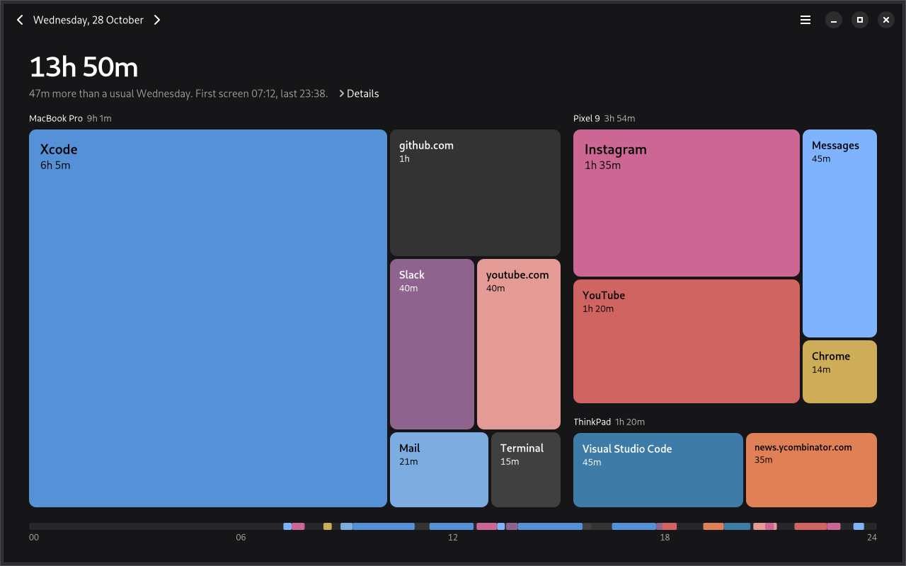

# Spent Day for Linux

GTK4 and libadwaita app that records which app has focus, and which site the browser extension
reports, and shows the dashboard for all your synced devices. It links `spentday-core` directly.
It stores app ids and names, domains, times and the device name. It never keeps, stores or sends
window titles, because a private browser window shows its page title there, and it never stores a
URL. On Sway, the window tree Spent Day reads includes every window's title. On Hyprland, the
reply includes the focused window's title. Spent Day takes the app id and ignores the rest.

## Day view

The dashboard shows one local calendar day. Its headline counts time on overlapping devices once.
**Details** shows simultaneous device time, the longest stretch, time after 23:00, and every app
and site ranked within its device. Browser time belongs to either its site or its app, without
counting both.

Use the header arrows or Ctrl+Left and Ctrl+Right to change days. The next arrow stops at today.
An open dashboard follows today across midnight unless a past day is selected. The weekday
comparison needs at least two of the previous four matching weekdays with data. Today compares
only up to the current local time.

Click a device label to open its group, then an item to see its sessions in time order. An item
also opens its sessions directly from the day view. Breadcrumbs and Escape go back. Tab and the
arrow keys move focus between tiles. Return and Space activate a tile. Hover shows the item's
sessions after 300 ms, with immediate updates between tiles. Items below 0.3% of the day total
share an **Other** tile. Details still lists each item.

The window follows the system light or dark style and the system animation preference. Tile
colours come from installed application icons, without displaying those icons. Sites and apps
without a matching local installation use a stable hue. Labels show only whole text that fits.

`spentday --demo` opens 28 October 2026 with the same items, sessions, and colour samples as the
macOS demo. The headline is 13h 50m, with 14h 15m of device time. Four earlier sample weekdays
use proportionally shorter sessions to exercise the 47-minute comparison. Other dates are empty.



Screenshots: [hover](screenshots/dashboard-hover-demo.png),
[device](screenshots/dashboard-device-demo.png), [sessions](screenshots/dashboard-sessions-demo.png),
[light](screenshots/dashboard-light-demo.png), [720 by 560](screenshots/dashboard-small-demo.png),
and [empty](screenshots/dashboard-empty-demo.png).

## Build and install

Needs Rust stable, a C compiler, pkg-config, and the development files for GTK 4.18 or later and
libadwaita 1.7 or later. On Debian 13 or Ubuntu 25.04:

```sh
sudo apt install build-essential pkg-config libgtk-4-dev libadwaita-1-dev
```

`PREFIX` installs somewhere other than `~/.local`. It must be an absolute path.

```sh
./install.sh             # ~/.local/bin/spentday, desktop entry, icon, autostart entry
./install.sh --systemd   # same, but a systemd --user service instead of autostart
```

After updating, log out and back in. On KDE, reloading the KWin script is enough, and install.sh
does that. Until then the old GNOME extension or KWin script stays loaded, and tracking fails.

The systemd service needs `WAYLAND_DISPLAY` or `DISPLAY` in the user manager's environment and
starts with `graphical-session.target`. GNOME and KDE provide both. Sway, Hyprland and most other
compositors provide neither unless configured, and install.sh warns with the line to add, such
as `exec systemctl --user import-environment WAYLAND_DISPLAY SWAYSOCK XDG_CURRENT_DESKTOP` for
Sway. These compositors do not run autostart entries either, so the simplest way to start
Spent Day there is a line in their config:

```sh
exec ~/.local/bin/spentday --background                # Sway
exec-once = ~/.local/bin/spentday --background         # Hyprland
```

`spentday` opens the window. `spentday --background` tracks without one, and closing the window
keeps tracking. Use "Stop Tracking and Quit" in the menu (Ctrl+Q) to end it. A second launch
opens the window in the running process. `spentday --demo` shows sample data and records nothing.

The database lives at `$XDG_DATA_HOME/spentday/spentday.db`. Set `SPENTDAY_DB` to use another file.
Its directory is created with mode 0700 and the database files with mode 0600, whatever the
umask, since the database holds the sync code. On start, Spent Day sets the default data folder
back to 0700 if it already exists. It leaves the folder of a `SPENTDAY_DB` file as it is.
Set `SPENTDAY_COLLECTOR` (`x11`, `sway`, `hyprland`, `gnome`, `kde`) to skip detection.

## Sessions

| Session | Focused app | Idle |
|---|---|---|
| X11 | `_NET_ACTIVE_WINDOW`, then its `WM_CLASS`, or the process name of `_NET_WM_PID` without one | XScreenSaver |
| Sway | `swaymsg -t get_tree` | `ext-idle-notify-v1`, else `org.freedesktop.ScreenSaver` if a service provides it |
| Hyprland | `hyprctl activewindow -j` | same as Sway |
| GNOME Wayland | `gnome-extension/`, which returns the focused window's app id only, and only to Spent Day (install.sh installs it, enable it after logging in again) | Mutter IdleMonitor |
| KDE Wayland | `kwin-script/` (install.sh installs and enables it) | `org.freedesktop.ScreenSaver` |

After 180 s without input the user counts as away from their last input on. An idle inhibitor
(logind `BlockInhibited` containing `idle`, or GNOME's `IsInhibited`), which video players and
browsers take while a video plays, keeps them present, and so does an MPRIS player playing in the
focused app. Music playing in another app does not. Spent Day checks for these every 5 s, idle or
not, so when the user leaves during a video, away starts when the video ends, or at their last
input if that came later. The checks run on a thread of their own and get 2 s per round, so a slow
or hung player never holds up focus tracking or heartbeats. A check that finds media keeps an idle
user present for 30 s. Checks that find nothing, fail or time out do not renew it, and neither does
a check thread that stops reporting, so away starts 30 s after the last check that found media and
counts from that check. A player between tracks loses no time. Spent Day remembers which app a player
belongs to until the player restarts, and a player that will not say whose it is does not keep the
user present. Media that plays again brings an away user back. `SPENTDAY_AWAY_AFTER_SECS` shortens the 180 s for testing.
On Sway and Hyprland the compositor holds the idle notice back while an app inhibits idle.
`ext-idle-notify-v1` watches the first seat the compositor lists. On a compositor with more
than one seat, input on another seat does not count, so a user working only there counts as away.
Typical single-seat desktops are not affected.
Without an idle source Spent Day logs a warning, and time away from the keyboard counts as time in
the focused app. It searches again after 5 s, after 30 s, then every 5 minutes, so a service
that was too slow to answer at login is still found.
Sleep and screen lock (logind) close the open span.

KWin scripts cannot answer D-Bus calls, so the installed script reports the app id at each focus
change, and on startup Spent Day loads a one-shot KWin script through `org.kde.kwin.Scripting`
that reports the app active right now. It writes that script to a new directory only the user can open, and
once the script has reported, unloads it and deletes the file.

Both helpers talk only to Spent Day. When it starts, Spent Day takes the session bus name
`day.spent.SpentDay.Focus` in a way that no other program can take it over. If another program
holds the name already, Spent Day says so and quits. The GNOME extension answers only the
current owner of that name and turns down every other caller. Spent Day takes focus reports only
from the connection that owns `org.kde.KWin`, which is the one KWin scripts call from.

## Known limits

- While Spent Day is not running, any unsandboxed process of the same user can take
  `day.spent.SpentDay.Focus`. It then reads the focused app from the GNOME extension, or gets the
  KWin script's reports. Such a process can read the database anyway.
- A Flatpak app may own names under its own app id, and `--own-name=` grants it others. So a
  Flatpak with the id `day.spent.SpentDay`, or one granted the name, can take it while it is free.
  To ask the GNOME extension it also needs access to talk to `org.gnome.Shell`.
- Any unsandboxed process of the same user can load its own KWin script through
  `org.kde.kwin.Scripting`. KWin sends that script's reports on its own connection, so Spent Day
  cannot tell them from real ones and records the app they name.
- `swaymsg` and `hyprctl` get 1 s to answer, then Spent Day kills their process group. A wrapper
  that starts a new session or runs the command outside the sandbox, such as `setsid` or
  `flatpak-spawn --host`, leaves that group, and its children can outlive the kill. Spent Day still
  stops waiting after 1 s, so tracking goes on, but those processes are left running.
- Presence is sampled every 5 s, so the moment media starts or stops is known to within 5 s.
  Away is back-dated to the last check that found media, so up to 5 s at the end of a video can
  go uncounted, or up to 10 s when the check after it could not tell.

## Checks

`./verify.sh` builds the dev container from `Dockerfile.dev` and runs the unit tests, the
extension's tests under Node, and the tests that need a session bus or an X server. Then it runs
end-to-end checks: X11 focus and idle, the browser extension (tabs, an incognito window, a new
tab, the popup's health check), a hung `swaymsg`, `install.sh`, and headless Sway focus and idle.
It saves screenshots to `screenshots/`. The GTK test checks tile focus, accessible labels,
drill activation, the delayed hover popover, local icon sampling, and colour fallback.

Inside the dev container, `cargo test` runs the layout and colour checks with literal expected
values from the macOS tests. `cargo test -p spentday-core` at the repository root checks the
shared day API. `CARGO_TARGET_DIR=/target apps/linux/snapshot.sh` at the root captures the seven
demo states under Xvfb after the Linux binary has been built into `/target`. The capture uses
libadwaita's test colour-scheme override and records no activity. `verify.sh` calls the same
script. The `xauth` package in `Dockerfile.dev` lets `xvfb-run` create its isolated display.

GNOME and KDE are checked with stand-ins. For GNOME, `tests/gnome-shell.js` loads the real
`gnome-extension/extension.js` in gjs, with a stub for the Shell's focused window, and Spent Day
tracks through it. For KDE, a fake KWin on the session bus answers the scripting calls, and a test
checks the one-shot script Spent Day loads and the reports it takes. Hyprland is checked only
against a recorded `hyprctl` reply. A real session is still needed for the extension inside
GNOME Shell, the KWin script inside KWin, Mutter's and KDE's idle sources, the GNOME and KDE steps
of `install.sh`, and Hyprland.
