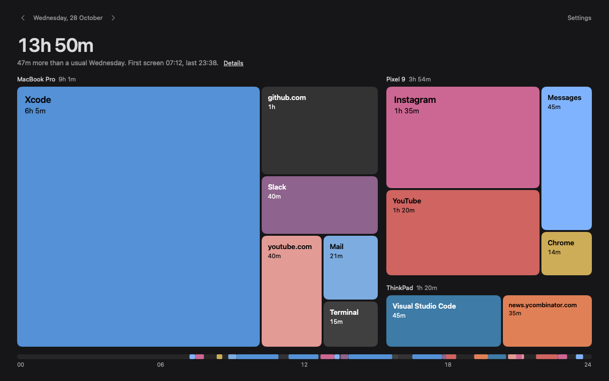

# Spent Day for macOS

A menu bar app on top of the Rust core. `build.sh` builds `build/Spent Day.app`, `install.sh` copies it to `/Applications`, `verify.sh` runs it end to end on a scratch database, and `test.sh` runs the collector's checks against the real core. `snapshot.sh` draws the images in `screenshots/` from demo data. It draws them offscreen and never opens the app.

It needs a Mac with Apple Silicon and Rust stable. The app runs on macOS 14 or later. Building needs Xcode 16 or later, or just its Command Line Tools, for Swift 6, and those need macOS 14.5 or later. `verify.sh` also needs jq. The scripts build for arm64 only, so Intel Macs aren't supported yet.

## Day view

The dashboard shows one local calendar day. Previous and next controls step days; Command-Left and Command-Right do the same. Next stops at today. The total counts time on overlapping screens once. Device groups show their separate totals.

Tiles show apps and sites without icons. Hover for sessions, click a device name to fill the map with that device, or click a tile to see its sessions in time order. Tab and arrow keys move focus, Return opens a tile, and Escape goes back. Details shows overlapping time, the longest stretch, time after 23:00, and every app and site per device. Items under 0.3% of the day share an Other tile.

The weekday comparison uses the previous four matching weekdays that have data. It appears only when at least two have data. For today, each historical sample ends at the current local time of day. Light and dark appearances follow the system. Tile colours come from local app icons or stable hashes, with black or white labels that keep at least 4.5:1 contrast when dimmed. Sites never fetch favicons.

Run `apps/macos/test.sh` for collector, day bounds, layout and colour checks. Run `apps/macos/snapshot.sh` for the fixed 28 October 2026 demo day in dark and light appearances, Xcode hover, device and session drills, a 720 by 560 window, an empty day, and the menu panel. Snapshot hover and drill states are injected. The snapshot comparison uses the reference day's supplied usual Wednesday total; live comparisons read historical days from the core. Demo sessions repeat on the requested local day, and demo colours stay fixed across machines.



A dev build can open a date with `--dashboard --day 2026-10-28`.

## Install

From the repository root:

```sh
apps/macos/make-dev-cert.sh   # once: a local signing cert so permissions survive rebuilds (may ask for your keychain password)
apps/macos/build.sh
apps/macos/install.sh         # copies Spent Day.app to /Applications and opens it
```

`make-dev-cert.sh` lets any program running as you sign code with that certificate. An Apple Development certificate, which needs the full Xcode, helps only if its private key's access control makes `codesign` ask for your password each time it signs. [Signing](#signing) explains both.

Each browser asks once whether Spent Day may read its tabs. Spent Day asks for the address of the tab in front and keeps only its domain. Safari sites are off by default, because Safari can't tell Spent Day which windows are private. You can turn them on in Settings > General.

## Data folder and dev build

The app keeps its database in `~/Library/Application Support/SpentDay`. It makes that folder `0700`, and sets it back to `0700` if it already exists, because the database holds the sync code. If it can't do either, it shows the error and quits.

`build.sh --dev` builds `build/dev/Spent Day.app`, which reads two environment variables. `SPENTDAY_DB` points it at another database, and `SPENTDAY_DEMO=1` shows demo data. `verify.sh` and the cross-device test use it. The normal build ignores both, and `install.sh` only installs the normal build. The dev build has the bundle id `day.spent.SpentDay.dev` and keeps its data in `~/Library/Application Support/SpentDay Dev`, so it can run beside the installed app without sharing its database.

## Signing

macOS ties the Automation grants to the app's signature. An ad-hoc signature changes on every build, so each rebuild asks for Automation again. `build.sh` signs with a stable identity when it finds one. It also turns on the hardened runtime, so other code can't be loaded into the app to borrow its grants. The only entitlement is sending Apple events to browsers. The hardened runtime doesn't help if another program can sign itself with the same identity. See `make-dev-cert.sh` below.

There are two ways to get a stable identity.

- **An Apple Development certificate.** Any free Apple account can make one in the full Xcode, under Settings > Accounts. The Command Line Tools can't. Set `SPENTDAY_SIGN_IDENTITY` to its name, such as `Apple Development: you@example.com (TEAMID)`. It is safer only if the private key's access control makes `codesign` ask for your password each time it signs. If you clicked Always Allow, or the key lets every app use it, any program running as you can sign as you without a prompt, as with `make-dev-cert.sh`. Keychain Access shows this under the key's Access Control tab.
- **`make-dev-cert.sh`.** It makes a self-signed "Spent Day Dev" certificate in your login keychain, without an Apple account. To do that it trusts the certificate for code signing, and it lets `/usr/bin/codesign` use the key without asking. So any program running as your user can sign code as "Spent Day Dev" without a prompt. A program that signs itself that way with the identifier `day.spent.SpentDay` gets Spent Day's Automation grants for your browsers, without injecting anything into Spent Day. Use it only on a Mac you don't share. To remove it, run `security delete-identity -c "Spent Day Dev" -t`. That deletes the certificate, its key and its trust setting. Searching Keychain Access for "Spent Day Dev" misses the key, which is labelled "Imported Private Key".

## Release signing

Run `scripts/make-release-cert.sh` from the repository root once. It creates a self-signed code-signing identity named `Spent Day Release`, valid for ten years, and writes its files into a temporary directory printed by the script. It does not change any keychain or call GitHub. No developer account or registration is needed.

The script prints the exact `gh secret set` commands for the repository secrets `MACOS_SIGN_P12` and `MACOS_SIGN_P12_PASSWORD`. Run those commands with an authenticated GitHub CLI, or upload the contents of `signing.p12.base64` and `password.txt` through the repository's Actions secrets settings. Keep `signing.p12` and its password together in a private backup, then remove the temporary directory. Reuse the same identity for later releases so Automation grants survive updates.

On tag pushes and manual workflow runs, the workflow imports the identity into a temporary keychain, trusts it for code signing, and deletes it after the build. Without the secrets, it signs ad hoc and prints a warning. Pull request builds always sign ad hoc, print a notice, and never import the release identity. Ad-hoc updates ask for Automation grants again. Release builds use the existing `build.sh` and are not notarized. Users allow the blocked launch with System Settings > Privacy & Security > Open Anyway after every download, including updates.

Once the workflow is on `main` and the secrets are configured, open Actions > Release > Run workflow, select `main`, and run it. This uploads artifacts without publishing a release. Check that Import release identity lists `Spent Day Release` and Build app and disk image prints `Signed with: Spent Day Release`. Download and unpack the `macos-arm64` artifact, open its DMG, then check the app in Terminal:

```sh
codesign --verify --strict '/Volumes/Spent Day/Spent Day.app'
codesign -dv --verbose=4 '/Volumes/Spent Day/Spent Day.app' 2>&1
```

Verification must succeed, and the signature details must not report `Signature=adhoc`. A pull request artifact reports `Signature=adhoc` instead.

## What it stores

It stores the app in front (bundle id and name), the domain of the browser tab in front, when each started and ended, and this Mac's name. It does not read window titles, so it needs no Accessibility access. For a browser it checks whether the front window is private, and if it isn't, reads the URL of that window's active tab. The core keeps only the URL's domain. The full URL and the page title are never stored or synced.

What it reads, and the permission each needs:

| What | How | Permission |
|---|---|---|
| App in front | `NSWorkspace` | None |
| Whether the front browser window is private, its id, and its active tab's URL | AppleScript to the browser | Automation, asked once per browser |
| Idle time | `CGEventSource` | None |
| Media holding the display awake | IOKit power assertions | None |
| Front window number, to tell windows apart | `CGWindowListCopyWindowInfo` | None |

## Private and incognito windows

When the front browser window is private, or its tab isn't an http(s) page, Spent Day sends no page and calls `web_cleared`, so the site shown before stops getting time. The URL of a private window never reaches the core.

One AppleScript call resolves the front window once, by id, checks whether it is private, and reads the active tab of that same window. If the call fails, no page is read, and the browser's time goes to whatever the extension reports, or to no site. A page is only used for the activation and front window it was read in. After an app switch or a window change, the browser is recorded with no page until it answers again.

| Browser | How a private window is detected |
|---|---|
| Chrome, Brave, Helium, Edge, Vivaldi, Opera | AppleScript `mode of w is "incognito"`, where `w` is the front window. The script returns nothing for it. Checked against the Chrome, Brave and Helium scripting dictionaries, and live in Chrome: an incognito window returns `{}`, a normal one its URL. Edge, Vivaldi and Opera are assumed to share Chrome's. |
| Arc | AppleScript `incognito of w`. Not checked against a real install. |
| Safari | It can't. Safari's scripting dictionary has no private-window property. So Safari sites are off by default: Spent Day never asks Safari for its page, calls `web_cleared`, and records Safari time with no site, which the dashboard shows as Safari. Settings > General > Record Safari sites turns them on, and then private browsing in Safari is recorded like any other window. |
| Firefox | The extension sends `"url": null` for a private window. |

Other browsers aren't scripted, so their time goes to whatever the extension reports, or to no site.
